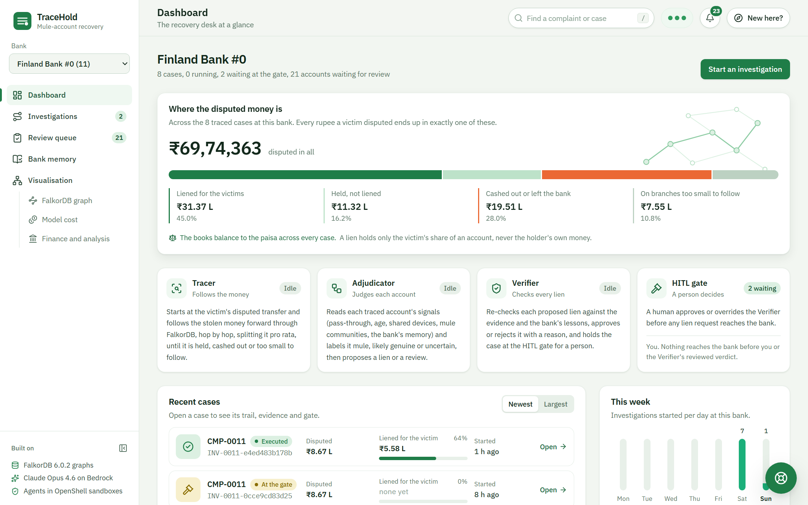
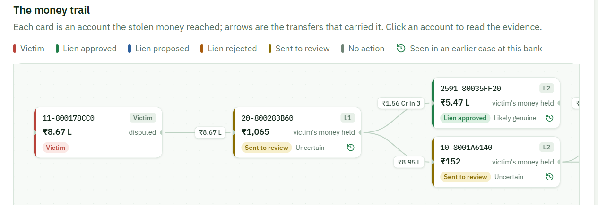
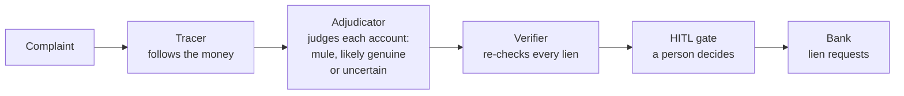
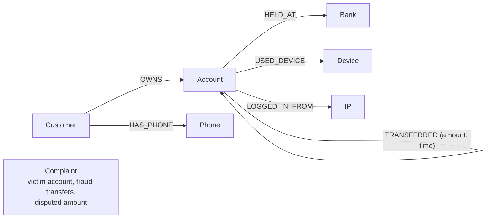

# TraceHold

TraceHold follows money stolen in a fraud through mule accounts (accounts used to pass stolen money on) and freezes only the stolen part of each account.

[Live demo](https://tracehold.duckdns.org) · Built for Graph Hacks 2026 (FalkorDB) · Track 1: Agents That Act on Connected Data · Track 2: Agent Memory and Coordination



## The problem

A fraud victim in India reports the theft on the 1930 helpline or the National Cyber Crime Reporting Portal, and by then the money has moved through several mule accounts, often mixed with other people's money. Banks often freeze whole accounts that the money touched, so innocent people lose access to all their money over a small disputed sum. India's rules are moving towards holding only the disputed amount: The Ministry of Home Affairs' procedure of 2 January 2026 limits holds to the disputed sum, and the Reserve Bank of India (RBI) has a draft to freeze only the disputed amount from 1 April 2027. Existing tools flag mule accounts but do not work out how much of an account is stolen money.

## What TraceHold does

1. It follows the stolen money forward in time, transfer by transfer, through the bank network stored as a graph in FalkorDB (a graph database: data stored as points and the links between them).
2. It works out how much of each account's balance is still the victim's money (the "taint"). The split is pro rata: if a third of the money that came into an account was stolen, a third of what leaves it is too.
3. It proposes a lien (a hold on part of a balance) for exactly that amount on each account, never a full freeze.
4. A person approves or overrides every lien before any request reaches the bank (HITL, human in the loop).



## How it works



- Three AI agents (Claude Opus 4.6) built with LangGraph (a library that runs an agent as a graph of steps). Each runs in its own NVIDIA OpenShell sandbox (a locked-down container that can reach only its own tools, the model and the tracing service; the model key never enters it).
- The agents never write database queries. They call fixed tools over MCP (Model Context Protocol, a standard way for an AI agent to call tools), and the tools run fixed Cypher queries (FalkorDB's query language).
- Seven deterministic checks (rules in code, not AI) run before the gate, and every amount comes from code, never from the model.
- Each bank keeps its own memory graph of past cases and lessons, so a person's override reason changes later decisions.
- A mock bank receives the lien requests.

## Graph data model



The network graph holds 518,581 accounts, 5,078,345 transfers, 30,470 banks, 1,039,498 IP addresses, 218,410 devices, 167,095 phones, 166,207 customers and 370 complaints.

Each bank also has its own memory graph, `memory_<bank>`, with Investigation, Decision, Lien, Lesson, Step and Message nodes. FalkorDB cannot join across graphs, so memory nodes point at network accounts by ID (EntityRef nodes). A lesson's confidence rises or falls with later decisions.

The tools run time-respecting multi-hop tracing in Cypher (each hop must happen after the money arrived), label propagation and WCC (two methods that find groups of connected accounts) to spot mule communities, and betweenness (how many paths pass through an account) to find hub accounts.

## Results

Amounts are in rupees (a lakh is 1,00,000 and a crore is 1,00,00,000). On 36 test complaints, TraceHold froze ₹1.85 crore of innocent money (money in accounts the dataset labels genuine), against ₹15,725 crore for freezing every account the money touched, ₹215.7 crore for a greedy trace (holding up to the disputed amount at every hop) and ₹76.4 crore for fixed rules with no AI. It held more stolen money than the rules (₹309.8 crore against ₹265.6 crore) but caught fewer mule accounts (59% against 70%). A second set of 41 complaints showed a much smaller saving over the rules.

## Try it

Open https://tracehold.duckdns.org (no login). If that name ever fails to load, the same site is at https://32-188-216-174.sslip.io.

1. Pick a bank in the sidebar (bank 11 is a good start).
2. Open Investigations, press "Start an investigation" and pick a complaint such as CMP-0011.
3. The three agents take one to three minutes. Open the case and approve or override at the HITL gate.
4. Open Visualisation, then FalkorDB graph, to replay how the agents built the trail and to see the queries FalkorDB is running.

"New here?" in the header gives a guided tour, and the help chat (bottom right) answers questions. Everyone shares the same demo banks. Each run costs about 15 to 25 US cents of model time, and the agents stop at a spend cap.

It runs on one AWS EC2 server (m7i.xlarge: 4 CPUs, 16 GB memory) because of compute constraints: The full graph needs about 6 GB of memory and the agent sandboxes need Linux. The server stays on through the judging period.

## Tech stack

| Part           | Technology                                                     |
| -------------- | -------------------------------------------------------------- |
| Graph database | FalkorDB 6.0.2                                                 |
| AI model       | Claude Opus 4.6 on Amazon Bedrock                              |
| Agents         | LangGraph                                                      |
| Tools          | MCP server (Python)                                            |
| Sandboxes      | NVIDIA OpenShell on Podman (containers)                        |
| Backend        | Python 3.13, Starlette and FastAPI                             |
| Web app        | React 19, Vite, TypeScript, Tailwind CSS, React Flow, Recharts |
| Tracing        | Langfuse (records each agent step and model call)              |
| Hosting        | AWS EC2 (Ubuntu), Caddy (HTTPS)                                |

## Run it yourself

You need a Linux server with 4 CPUs, 16 GB memory and 40 GB disk (Ubuntu 26.04 was used), an Amazon Bedrock API key with access to Claude Opus 4.6 in us-east-2, Langfuse API keys (for tracing the agents' steps; the sandbox setup stops without them), and IBM's synthetic anti-money-laundering dataset (the HI-Small files) from [Kaggle](https://www.kaggle.com/datasets/ealtman2019/ibm-transactions-for-anti-money-laundering-aml).

```bash
# on the server, as a normal user with sudo rights (not root), in your home folder
git clone https://github.com/SHIVANI-PONTURU/Tracehold.git TraceHold && cd TraceHold
cp .env.example .env              # add your BEDROCK_API_KEY, LANGFUSE_PUBLIC_KEY and LANGFUSE_SECRET_KEY
# copy HI-Small_Trans.csv, HI-Small_accounts.csv and HI-Small_Patterns.txt into this folder
bash deploy/ec2_setup.sh          # installs Podman, OpenShell, Python and Node, builds the agent image and the web app
bash deploy/ec2.sh build-graph    # builds the graph from IBM's data (about 25 minutes)
bash deploy/ec2.sh start          # starts FalkorDB, the tool server, the mock bank, the web app and the three agents
```

- Open it through an SSH tunnel: run `ssh -i <key.pem> -N -L 8501:127.0.0.1:8501 ubuntu@<server>` on your own computer, then browse to http://localhost:8501. Or give it a public HTTPS address with Caddy (the steps, and the two names to change, are at the top of `deploy/Caddyfile`).
- `bash deploy/ec2.sh enable-boot` starts it at every boot, and `bash deploy/ec2.sh stop` stops it.
- Unit tests (no database needed, run from the repository folder): `~/.venvs/tracehold/bin/python -m pytest -m unit`

## Repository layout

```text
agents/                   the three agents and the model client
mcp_server/               the tools the agents call, and the handoff API
taint/, safety/           the taint engine, the seven checks and the lien guard
graph/, memory/           FalkorDB access, the network and per-bank memory graphs
handoff/, bank_api/       case states, spend ledger, the mock bank
web/, ui_server/          the web app and the server that serves it
data/, synthetic/, eval/  data pipeline, the synthetic overlay, the evaluation
sandbox/, deploy/         sandbox policies, server scripts
tests/                    unit and integration tests
docs/                     queries, sandbox rules, contracts, build reports
```

## Data

TraceHold uses IBM's public synthetic anti-money-laundering data (about 5 million transfers) plus a synthetic overlay (amounts converted to rupees, times read as Indian time, and generated opening balances, account ages, devices, phones, IP addresses and fraud complaints). Bank names are IBM's own (for example Finland Bank #0), and there is no real customer data. The model runs in AWS's US regions, so a real Indian deployment would need a model hosted in India (RBI's payment data storage rule).

## Built with AI tools

Claude Code (Anthropic's AI coding assistant) helped write the code. The agents in the product run on Claude Opus 4.6.

## More

- [docs/QUERIES.md](docs/QUERIES.md): Every Cypher query and why it exists
- [docs/SANDBOX.md](docs/SANDBOX.md): What each sandbox may reach
- [docs/CONTRACT.md](docs/CONTRACT.md): The tools and handoffs
- Read the Blog post at [TraceHold: Preventing Fraudsters from Escaping Justice](https://medium.com/@tracehold.1/tracehold-preventing-fraudsters-from-escaping-justice-7a03c50bc1eb)
